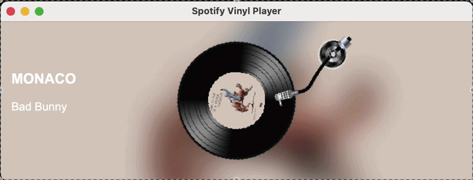

# 🎵 Spotify Vinyl Player - Python Edition

A stylish, interactive desktop application that brings your **Spotify** playback to life with a retro vinyl record animation. This project uses Python to fetch real-time data from Spotify and displays it on a dynamic, blurred-background GUI.

---

##  Overview
This application connects to your Spotify account and:
* **Tracks Live Music**: Detects what you are currently listening to.
* **Dynamic Visuals**: Downloads album art and transforms it into a rotating vinyl sticker.
* **Immersive UI**: Features a blurred background based on the current album cover.
* **Animated Elements**: Includes a spinning vinyl record and a classic record player arm.

---

##  Features
*  **Real-time Synchronization**: Polling system that updates the song info every 2 seconds.
*  **Smooth Animation**: High-frequency rotation loop (20ms) for a realistic spinning effect.
*  **Image Processing**: Uses the `PIL` (Pillow) library for Gaussian blurs, circular masks, and rotations.

---

##  Tech Stack
* **Language:** Python 3.x
* **GUI Framework:** `tkinter`
* **API:** [Spotipy](https://spotipy.readthedocs.io/) (Spotify Web API wrapper)
* **Image Handling:** `Pillow` (PIL)
* **Networking:** `requests`

---

##  Preview



##  Prerequisites & Setup

1. **Spotify Developer Account:**
   * Create an app on the [Spotify Developer Dashboard](https://developer.spotify.com/dashboard).
   * Set the Redirect URI to: `https://github.com/lorenkr/spotify-turntable/blob/main/docs/callback.html`

2. **Environment Variables:**
   Create a `.env` file in the root directory and add your credentials:
   ```env
   CLIENT_ID=your_client_id_here
   CLIENT_SECRET=your_client_secret_here


   
